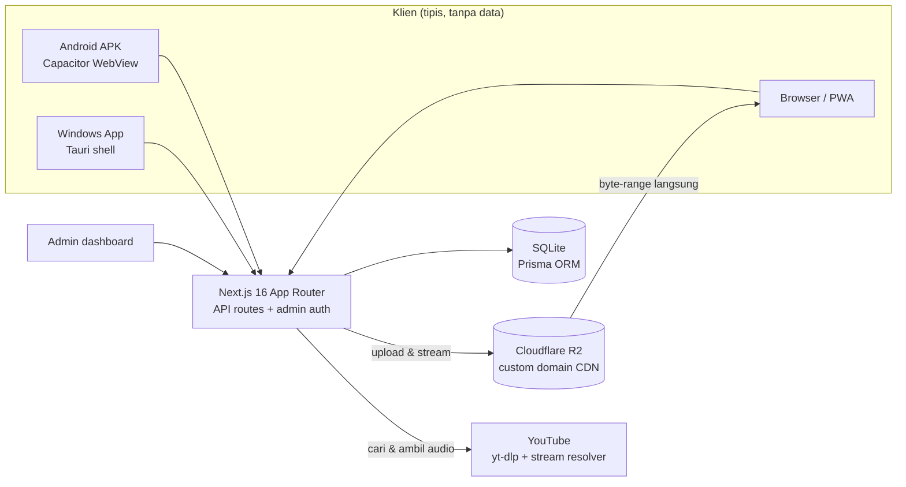

# VibeMZ — Platform Musik Self-Hosted (Web · Android · Windows)

**Semua musikmu tinggal di server sendiri — tetap bisa diputar dari browser, HP, dan laptop.**

---

## Masalahnya

Musik yang **kamu** punya dan musik yang **boleh kamu putar** itu dua hal berbeda, dan
keduanya sama-sama tidak nyaman:

- Layanan streaming berlangganan: harganya naik terus, ada iklan, dan katalognya
  ditentukan label — lagu favorit bisa hilang kapan saja
- Koleksi sendiri (MP3 beli/ripping/CD) berceceran di folder; diakses dari luar rumah
  harus buka file manager lewat remote, tanpa antrean, lirik, atau equalizer
- Solusi NAS klasik memang menyimpan file, tapi UI-nya file manager — bukan pemutar
  musik: tidak ada crossfade, visualizer, rekomendasi, atau tampilan "now playing"
- Aplikasi jadi-jadian menyuruh upload koleksi pribadi ke cloud orang lain — koleksi
  kamu numpang di server yang bukan milikmu, dan bisa hilang bersama layanannya

## VibeMZ

Satu aplikasi Next.js yang berperan sebagai **"Spotify pribadi"**: perpustakaan musik
milik sendiri, diputar dari server sendiri, dengan pengalaman dengar yang serius.

| | |
| :--- | :--- |
| **Server sendiri** | Lagu, database, dan kredensial tinggal di mesinmu (homeserver Linux, VPS, atau Docker) |
| **Akses dari mana saja** | Browser, PWA installable, shell Android, dan aplikasi Windows — semuanya memutar dari server yang sama |
| **Katalog = milikmu** | Upload lagu sendiri, susun playlist per kategori, tanpa katalog pihak ketiga yang bisa menarik lisensi |
| **Tambah dari YouTube** | Cari dan simpan lagu dari YouTube saat koleksi lokal belum punya — jadi bagian perpustakaan yang sama |
| **Audio lewat CDN** | File dilayani dari Cloudflare R2 lewat custom domain; server tidak jadi bottleneck saat beberapa orang memutar bersamaan |

## Fitur

### Pemutar

- **Crossfade dua elemen** — transisi antar lagu tanpa jeda, gain diramp dengan Web Audio API
- **Equalizer 5-band** (lowshelf, tiga peaking, highshelf) dengan preset
- **Visualizer waveform** real-time dari `AnalyserNode`
- **Panel lirik** yang bisa dibuka-tutup, plus **cover otomatis** dari thumbnail YouTube untuk lagu tanpa artwork
- **Preload tiga tingkat** — lagu berikutnya (crossfade), antrean 3–5, dan lagu trending; klik terasa instan karena blob sudah siap
- **Media Session API** — kontrol putar/jeda dari notification bar dan lock screen
- **Wake Lock** — Android tidak mematikan audio saat layar mati
- **Playback persistence** — volume dan posisi lagu bertahan setelah refresh

### Perpustakaan & Discover

- **Upload musik lokal** dengan ekstraksi metadata otomatis (durasi, artist) dan validasi magic bytes MP3/M4A
- **Home Library** untuk semua lagu + **playlist kategori** di sidebar, lengkap dengan pencarian
- **Discover** — pencarian dan trending YouTube (cache 30 menit) tanpa keluar dari aplikasi
- **Impor playlist YouTube** — tempel URL, ambil metadata sampai 100 lagu, unduh paralel, dedup otomatis
- **Infinite scroll** dan skeleton loading di semua halaman

### Admin dashboard

- CRUD lagu & kategori, edit metadata, hapus single maupun batch
- **Status per lagu** (`OK` / `BAD` / `PENDING`) — lagu rusak bisa diperbaiki satu klik tanpa menyentuh database
- **Batch action** lewat sticky bar, keyboard shortcut, dan sort per kolom
- **Manajemen cookies YouTube** — paste cookies baru, validasi struktur, live test, plus link rahasia untuk update dari jarak jauh
- **Rate limiting per IP**, **ban/unban IP**, dan **log pengunjung** dengan dedup
- **Health endpoint** — latensi DB, disk, memori, jumlah upload, umur cookies

### Storage & operasional

- **Dual-write** — file ditulis ke cache lokal dulu, lalu diunggah ke R2 di latar belakang; URL database otomatis pindah ke CDN, lokal tetap jadi fallback
- **Cache eviction LRU** harian dengan verifikasi R2 sebelum file lokal dihapus
- **Backup harian** (database + `.env` + cookies), rotasi log PM2, dan cron maintenance yang sadar-jadwal (catch-up kalau mesin sempat mati)
- **Streaming byte-range** untuk seek, baik dari R2 maupun dari disk lokal

## Arsitektur

**Alur satu lagu:** admin mengunggah MP3 → ditulis ke cache lokal dan diunggah ke R2 →
database menyimpan URL CDN → pemutar mengambil audio langsung dari CDN (bukan lewat
server), sementara lagu berikutnya sudah di-preload sebagai blob.

## Satu server, tiga bentuk aplikasi

| Platform | Bentuk | Catatan |
| :--- | :--- | :--- |
| **Web / PWA** | Next.js, installable | Semua fitur; bisa dipasang ke home screen |
| **Android** | APK berbasis Capacitor | Shell WebView + plugin audio native; diuji di Android 9 / RAM 2 GB, sadar Doze mode |
| **Windows** | Aplikasi desktop (Tauri) | Jendela sendiri, kontrol media terintegrasi Windows |

Ketiganya **bukan aplikasi terpisah**: tidak ada lagu maupun logika bisnis di dalam shell —
semuanya memutar dari server yang sama, jadi update fitur tidak perlu build ulang aplikasi.

## Stack

Next.js 16 (App Router) · React 19 · TypeScript · Prisma + SQLite · Tailwind CSS v4 ·
Zustand · Web Audio API · Cloudflare R2 (S3 SDK + presigned URL) · yt-dlp ·
Capacitor (Android) · Tauri (Windows) · Docker · PM2

## Yang membuatnya tidak sekadar "folder MP3 dengan UI"

- **Latensi diukur, bukan dikira-kira** — direct CDN ~1,1–1,3 s untuk file 5 MB dan TTFB
  ~0,16 s dengan beban server nol; blob cache membuat lagu yang sudah di-preload instan
- **Tahan dipakai orang lain** — rate limit per IP, validasi magic bytes, guard admin di
  semua endpoint, dan ban IP untuk penyalahgunaan
- **Tahan mesin mati** — cron maintenance mengejar jadwal yang terlewat, backup harian,
  dan eviction hanya jalan setelah R2 diverifikasi

---

## English

**VibeMZ** is a self-hosted music platform. Your library stays on your own server and is playable from the browser, an Android app, and a Windows app.

It covers what a personal music server needs: player, library and discovery, an admin dashboard, and storage management.

The source code is not published; this repository documents the product.

---

## Lisensi

Ide, arsitektur, dan dokumentasi produk di repo ini dipublikasikan sebagai portofolio.
**Source code VibeMZ tidak dipublikasikan** — lihat [LICENSE](./LICENSE).
